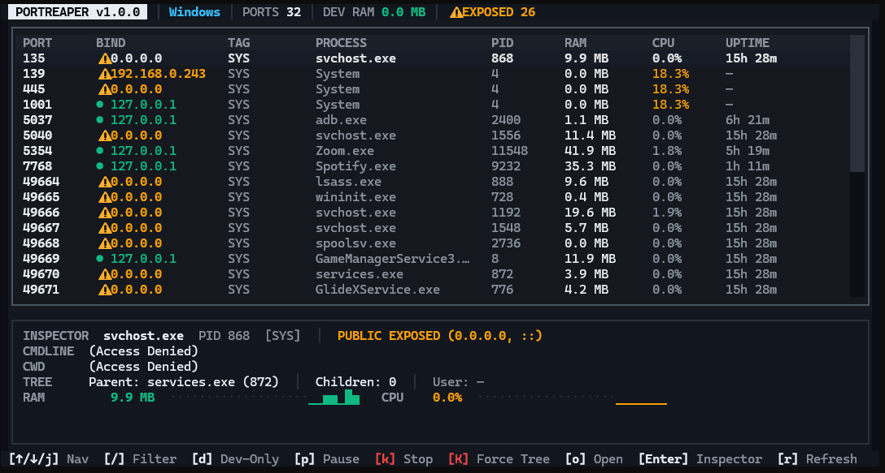
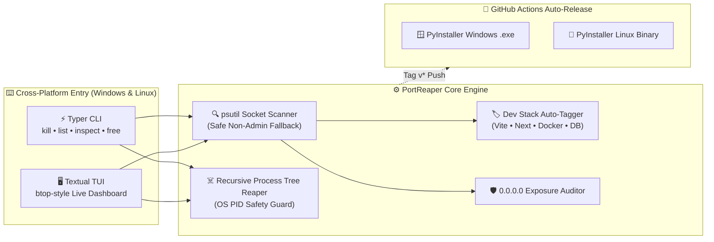

<a id="readme-top"></a>

<!-- HERO ANIMATED BANNER -->
<div align="center">
  

  <!-- ANIMATED TYPING TERMINAL PREVIEW -->
  <a href="https://github.com/a1n2a3s6/portreaper">
    
  </a>

  <br />

  <!-- PLATFORM & STACK BADGES -->
  <p>
    
    
    
    
    
  </p>

  <!-- LIVE GITHUB REPOSITORY STATS -->
  <p>
    <a href="https://github.com/a1n2a3s6/portreaper/stargazers">
      
    </a>
    <a href="https://github.com/a1n2a3s6/portreaper/releases">
      
    </a>
    <a href="https://github.com/a1n2a3s6/portreaper/commits/main">
      
    </a>
    
  </p>

  <!-- QUICK NAVIGATION BAR -->
  <p>
    <a href="#-the-problem-it-kills"><strong>🎯 Why PortReaper</strong></a> &nbsp;│&nbsp;
    <a href="#-terminal-ui-preview"><strong>🖥️ TUI Preview</strong></a> &nbsp;│&nbsp;
    <a href="#-installation-windows--linux"><strong>📦 Install</strong></a> &nbsp;│&nbsp;
    <a href="#-cli-power-commands"><strong>⚡ CLI Commands</strong></a> &nbsp;│&nbsp;
    <a href="#-keybindings"><strong>⌨️ Keybindings</strong></a> &nbsp;│&nbsp;
    <a href="#-architecture"><strong>🏗️ Architecture</strong></a>
  </p>
</div>

## 🖥️ Terminal UI Preview



---

> [!IMPORTANT]
> **Never Google `netstat -ano | findstr :3000` or `lsof -i :3000` again.**
> **PortReaper** is a native **Windows & Linux** keyboard-first Terminal UI & CLI tool that gives you instant X-ray vision into every listening port, tags your dev stack automatically (`Vite`, `Next.js`, `Docker`, `Postgres`, `Redis`), flags risky `0.0.0.0` exposures, and kills stuck process trees in one keystroke.

---

## 🎯 The Problem It Kills

| Daily Developer Pain | ☠️ PortReaper (Win & Linux) | Old OS Commands (`netstat` / `lsof`) |
| :--- | :---: | :---: |
| **Kill Port 3000 & 5173 Instantly** | `portreaper kill 3000 5173` | 3–4 cryptic piped commands |
| **Same UX on Windows & Linux** | ✅ 100% Identical | ❌ Completely different syntax |
| **Auto-Detect Dev Stack (`Vite`, `Docker`, `DB`)** | ✅ Built-In Smart Tagger | ❌ Only raw `node.exe` / PID |
| **Recursive Child Process Tree Cleanup** | ✅ Kills zombie workers too | ❌ Leaves orphan processes |
| **Spot Exposed `0.0.0.0` Security Risks** | ✅ Amber Warning Badge | ❌ Buried in raw text |
| **Interactive Live TUI + Browser Launch (`o`)** | ✅ `btop`-style 0ms TUI | ❌ Static text dump |

---

## 🖥️ Terminal UI Preview

```text
┌─ PORTREAPER v1.0 ─── [WINDOWS / LINUX] ─── PORTS: 7 ─── DEV RAM: 642 MB ─── ⚠ EXPOSED: 2 ─┐
│  Filter (/): [ dev-only: ON ]                                            [Auto-Refresh: 1.5s]│
├────────┬───────────┬──────────┬──────────────┬───────┬─────────┬───────┬─────────────────────┤
│  PORT  │   BIND    │   TAG    │   PROCESS    │  PID  │   RAM   │  CPU  │       UPTIME        │
├────────┼───────────┼──────────┼──────────────┼───────┼─────────┼───────┼─────────────────────┤
│ ▶ 5173 │ 127.0.0.1 │ VITE     │ node         │ 14820 │  142 MB │  1.4% │ 00:42:18            │
│   3000 │ 0.0.0.0 ⚠ │ NEXT.JS  │ node         │ 19204 │  286 MB │  3.2% │ 01:15:09            │
│   8000 │ 127.0.0.1 │ PYTHON   │ uvicorn      │ 22011 │   88 MB │  0.6% │ 00:12:44            │
│   5432 │ 127.0.0.1 │ POSTGRES │ postgres     │  4112 │   94 MB │  0.2% │ 04:08:51            │
│   6379 │ 0.0.0.0 ⚠ │ REDIS    │ redis-server │  5098 │   32 MB │  0.1% │ 04:08:50            │
├────────┴───────────┴──────────┴──────────────┴───────┴─────────┴───────┴─────────────────────┤
│ INSPECTOR ▸ PID 14820 (2 child workers)  │ RAM ▂▃▃▄▃▅▄▃ │ CWD: ~/projects/pulse-api-studio   │
│ CMD: node ./node_modules/vite/bin/vite.js --port 5173                                        │
└─ [j/k] Move  [/] Filter  [d] Dev-Only  [k] Stop  [K] Force Kill  [o] Open Browser  [q] Quit ─┘
```

---

## 📦 Installation (Windows & Linux)

### Option 1: Standalone Pre-Built Binary (No Python Required)
Download the latest executable directly from **[GitHub Releases](https://github.com/a1n2a3s6/portreaper/releases)**:
- **Windows:** `portreaper-windows-x64.exe`
- **Linux:** `portreaper-linux-x64` (`chmod +x portreaper-linux-x64 && sudo mv portreaper-linux-x64 /usr/local/bin/portreaper`)

### Option 2: Install via `pipx` / `pip` (Recommended for Developers)
```bash
# Clone & install globally as a native CLI command
git clone [https://github.com/a1n2a3s6/portreaper.git](https://github.com/a1n2a3s6/portreaper.git)
cd portreaper
pip install .
```

> [!TIP]
> On **Linux**, running `sudo portreaper` unlocks full command-line inspection for root-owned system daemons (like Docker or Nginx). On **Windows**, standard PowerShell shows all user dev servers without Admin rights.

---

## ⚡ CLI Power Commands

Launch the interactive TUI or run zero-friction one-liners straight from PowerShell, CMD, Bash, or Zsh:

```bash
# Launch the live interactive Terminal UI
portreaper

# Kill one or multiple stuck ports instantly (Windows & Linux)
portreaper kill 3000
portreaper kill 3000 5173 8080 --force

# Print a clean table of active developer ports only
portreaper list --dev

# Audit only ports publicly exposed on 0.0.0.0 / ::
portreaper list --exposed

# Deep-inspect what is running on a specific port (CMD, CWD, child workers)
portreaper inspect 5173

# Find the nearest free port starting from 3000
portreaper free 3000
```

---

## ⌨️ Keybindings

| Key | Action |
| :---: | :--- |
| <kbd>j</kbd> / <kbd>k</kbd> or <kbd>↑</kbd> / <kbd>↓</kbd> | Navigate listening ports |
| <kbd>/</kbd> | Instant live fuzzy filter (by port, process, tag, or path) |
| <kbd>d</kbd> | Toggle **Dev-Only Mode** (hides noisy OS background ports) |
| <kbd>k</kbd> | Graceful stop (`SIGTERM`) on selected process |
| <kbd>K</kbd> | **Force Kill (`SIGKILL`)** process + entire child worker tree |
| <kbd>o</kbd> | Open `http://localhost:<port>` directly in your default browser |
| <kbd>p</kbd> | Pause / resume live 1.5s auto-refresh |
| <kbd>r</kbd> | Force immediate port rescan |
| <kbd>q</kbd> | Quit PortReaper |

---

## 🏗️ Architecture



<details>
<summary><b>📂 Click to expand full package structure</b></summary>

```text
portreaper/
├── .github/
│   └── workflows/
│       └── release.yml          # Automated Windows .exe & Linux binary builds
├── src/
│   └── portreaper/
│       ├── __init__.py
│       ├── __main__.py          # Entry point
│       ├── models.py            # PortEntry & ProcessDetails dataclasses
│       ├── scanner.py           # Cross-platform socket scanner & Dev Stack tagger
│       ├── killer.py            # Graceful/Force recursive process tree terminator
│       ├── cli.py               # Typer + Rich CLI commands
│       └── tui/
│           ├── app.py           # Keyboard-first Textual TUI dashboard
│           └── theme.tcss       # Industrial charcoal + amber/emerald stylesheet
├── pyproject.toml
├── requirements.txt
└── README.md
```

</details>

---

## 🗺️ Roadmap

- [x] Cross-platform Windows & Linux port scanner with safe non-admin fallback
- [x] `btop`-inspired Textual TUI with Vim navigation & live inspector drawer
- [x] Multi-port CLI killer (`portreaper kill 3000 5173`) with recursive child cleanup
- [x] Automated GitHub Actions standalone `.exe` & Linux binary release pipeline
- [ ] Port Watchdog mode (`portreaper watch 3000` with desktop notifications on crash)
- [ ] Docker container name resolution for mapped host ports
- [ ] Publish to PyPI (`pipx install portreaper`) & Winget / Homebrew

---

## 🤝 Contributing & License

Pull requests, bug reports, and OS edge-case improvements are always welcome!
Distributed under the **MIT License**.

---

<div align="center">

<h3>👨‍💻 Built by Anas Alhelaly</h3>
<p><em>Day 10 Milestone of my <strong>365 Projects in 365 Days</strong> GitHub Challenge</em></p>

<p>
  <a href="https://anas-alhelaly.vercel.app/">
    
  </a>
  <a href="https://github.com/a1n2a3s6">
    
  </a>
  <a href="https://www.instagram.com/anas.alhelaly/">
    
  </a>
</p>

<p>⭐ <strong>If PortReaper saved you from another <code>EADDRINUSE</code> headache, drop a Star on the repo!</strong> ⭐</p>

<p><a href="#readme-top"><strong>⬆️ Back to Top</strong></a></p>

<!-- ANIMATED WAVE FOOTER -->


</div>
